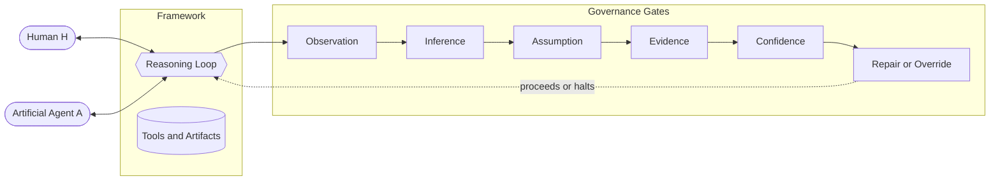

<div align="center">

# 🧭 Epistemic Governor Loops

### Calibration dynamics in structured human-AI reasoning systems

**A research instrument for separating observation, inference, assumption, conclusion, and confidence before certainty outruns evidence.**


[**Research Note**](./docs/research-note-001.md) ·
[**Protocol**](./protocol/governor-protocol.md) ·
[**Annotation Rubric**](./protocol/annotation-rubric.md) ·
[**Gate Theory**](./docs/gate-theory.md) ·
[**Preregistration**](./protocol/preregistration.md)

</div>

> **Current status — November 2026:** The repository contains a coherent research design, a HAM architecture ontology, an epistemic-gate framework, pilot metrics, synthetic scenarios, and an annotation package. It does **not** contain validated evidence that governed human-AI loops improve calibration or constitute a system-level intelligence property.

> **Synthetic instrument boundary:** The v0.0.1 prototype direction is controlled, local, and synthetic-only. It must not collect real participant identities, confidential prompts, consequential decisions, or protected human-subject data. No participant study has been authorized by this README alone.

---

## The research question

**Can a human and an AI, with distinct reasoning deficiencies, form a coupled feedback system that is more epistemically calibrated than either participant operating independently?**

The working hypothesis is that calibration may depend on both **participant capability** and **interaction architecture**:

```text
Human + AI
  → Human + AI + Governance
  → Human + Artificial + Mechanical Participants
  → Framework
  → Governance
  → Epistemic Gates
  → Measured Calibration
```

This is a hypothesis about *observable interaction properties*, not a claim that a model has been trained or that intelligence has emerged from the loop.

## What is established

The repository has established these **design decisions and observations**:

- Human-AI dialogue can exhibit confidence creep and assumption drift.
- Humans and AI may both introduce unsupported claims or repair unsupported claims made by the other.
- A bounded reasoning chain can be separated into observations, inferences, assumptions, conclusions, and confidence estimates.
- Candidate interaction metrics have been defined:
  - **CCR** — Confidence Creep Rate
  - **ADR** — Assumption Drift Rate
  - **CAS** — Calibration Alignment Score
  - **BCE** — Bidirectional Correction Events
- Synthetic scenarios and judge-facing annotation materials have been committed for instrument rehearsal.

## What is not established

The following remain **provisional, unmeasured, or untested**:

| Question | Current status |
|---|---|
| Does structured governance improve calibration? | **Hypothesis** |
| Is calibration a property of the loop rather than a participant? | **Stretch hypothesis** |
| Does the protocol preserve creativity and idea generation? | **Not tested** |
| Does the governor outperform reflection alone? | **Not tested** |
| Are the current metric scales valid and reliable? | **Validation required** |
| Does the protocol work across domains or participants? | **Not established** |
| Is any effect causal? | **No pilot evidence yet** |

> A negative or null result is a valid research outcome. A pilot effect does not establish mechanism, causality, architectural emergence, or external validity.

---

## Architecture



### HAM ontology

| Symbol | Class | Role |
|---|---|---|
| **H** | Human agent | initiates, judges, authorizes, and may override |
| **A** | Artificial agent | synthesizes, proposes, critiques, and generates alternatives |
| **M** | Mechanized agent | acts through deterministic or closed-loop state transitions |
| **T** | Tool or artifact | stores state or extends capability without independently initiating a transition |
| **G** | Governance | defines gates that constrain permissible state transitions |

For definitions and unresolved boundaries, see [HAM ontology](./docs/ham-ontology.md) and [open questions](./docs/open-questions.md).

---

## Governed interaction loop

```text
Observed fact
  → Observation gate
  → Inference
  → Assumption gate
  → Evidence gate
  → Confidence gate
  → Conclusion
  → Review and repair
```

Every gate resolves to:

| State | Meaning |
|---|---|
| **PASS** | Required support threshold is met; transition proceeds |
| **FAIL** | Support is insufficient or uncertain; transition halts or is repaired |
| **OVERRIDE** | A failure is explicitly acknowledged and permitted by an authorized human; uncertainty remains logged |

Governance should be paced to the reversibility and impact of the decision. Low-risk reversible work needs lighter gates; consequential work requires stronger review. See [governance pacing](./docs/governance-pacing.md).

---

## Pilot conditions

| Condition | Structure | Purpose |
|---|---|---|
| **A — Standard** | Normal AI dialogue | Baseline comparison |
| **B — Reflection** | Pause and reconsider observations, alternatives, and confidence | Test whether simple reflection explains any effect |
| **C — Epistemic Governor** | Observation, inference, assumption, conclusion, evidence, confidence, and review | Test structured governance against both controls |

The initial feasibility pilot is proposed at 20–30 participants. This scope estimates feasibility and measurement behavior; it is not powered for confirmatory publication.

## Candidate calibration metrics

| Metric | Working definition | Direction | Status |
|---|---|---|---|
| **CCR** | Unjustified confidence upgrades divided by eligible confidence statements | Lower | Operationalization in progress |
| **ADR** | Unsupported assumptions divided by total claims | Lower | Operationalization in progress |
| **CAS** | 1 − normalized mismatch between evidence strength and confidence strength | Higher | Validation required |
| **BCE** | Conversation events in which unsupported reasoning is detected and repaired or explicitly rejected | Process measure | Coding in progress |

See:

- [Confidence Creep Rate](./metrics/confidence-creep-rate.md)
- [Assumption Drift Rate](./metrics/assumption-drift-rate.md)
- [Calibration Alignment Score](./metrics/calibration-alignment-score.md)
- [Bidirectional Correction Events](./metrics/bidirectional-correction-events.md)
- [Annotation rubric](./protocol/annotation-rubric.md)

---

## Synthetic MVP: v0.0.1 direction

The controlled instrument prototype is designed to be **local, synthetic, and non-predictive**.

```text
One synthetic scenario
  + three interaction conditions
  + structured reasoning fields
  + pass / fail / override gate events
  + judge-ready session export
  + no external AI calls
  + no real participant storage
```

### MVP scope

- one fictional intermittent-failure scenario;
- standard, reflection, and governor modes;
- observation, inference, assumption, conclusion, and confidence fields;
- evidence and confidence ratings on 0–5 scales;
- gate-event logging;
- synthetic CAS/CCR/ADR/BCE rehearsal;
- downloadable JSON or Markdown session record;
- prominent synthetic-use warning;
- no account system, database, API key, or live-provider integration.

### Not in v0.0.1

- participant recruitment or consent collection;
- real human-subject data storage;
- live model prompting;
- consequential recommendations;
- efficacy claims;
- emergent-intelligence claims;
- multi-agent HAM topologies;
- production authentication or hosting;
- automated causal interpretation.

The prototype is complete only as an instrument once independent judges can rehearse the rubric reproducibly against synthetic transcripts.

---

## Research workflow

```mermaid
flowchart LR
    Observation[Observe interaction] --> Instrument[Operationalize metrics]
    Instrument --> Rehearse[Judge synthetic transcripts]
    Rehearse --> Reliability[Test inter-rater reliability]
    Reliability --> Preregister[Lock pilot protocol]
    Preregister --> Review[Ethics or institutional review]
    Review --> Pilot[Feasibility pilot]
    Pilot --> Analyze[Report effects and uncertainty]
    Analyze --> Mechanism[Test competing explanations]
```



Before pilot collection:

- [ ] lock the primary outcome;
- [ ] complete coding rules and denominators;
- [ ] validate all four scenarios;
- [ ] train independent judges;
- [ ] test inter-rater reliability;
- [ ] timestamp the preregistration;
- [ ] obtain required ethics review;
- [ ] establish secure de-identification and storage.

---

## Repository layout

```text
epistemic-governor-loops/
├── analysis/
│   ├── pilot-analysis-plan.md
│   └── synthetic-transcript-and-judge-example.md
├── data/
│   └── README.md
├── docs/
│   ├── research-note-001.md
│   ├── ham-ontology.md
│   ├── framework-governance.md
│   ├── gate-theory.md
│   ├── governance-pacing.md
│   └── open-questions.md
├── metrics/
│   ├── confidence-creep-rate.md
│   ├── assumption-drift-rate.md
│   ├── calibration-alignment-score.md
│   └── bidirectional-correction-events.md
├── protocol/
│   ├── governor-protocol.md
│   ├── annotation-rubric.md
│   ├── scenarios-v1.md
│   └── preregistration.md
└── paper/
```

## Start here

1. Read [How to use this repository](./docs/how-to-use-this-repository.md).
2. Review [Research Note 001](./docs/research-note-001.md).
3. Inspect [gate theory](./docs/gate-theory.md).
4. Rehearse the [synthetic judge example](./analysis/synthetic-transcript-and-judge-example.md).
5. Use [the annotation rubric](./protocol/annotation-rubric.md) without claiming pilot validity.
6. Do not collect human-subject data until approval, preregistration, and data controls are complete.

## Claim language

| Label | Meaning |
|---|---|
| **Observed** | Documented directly in repository artifacts or tested synthetic material |
| **Provisional** | A current design decision subject to revision |
| **Hypothesis** | A preregistered or preexperimental proposition |
| **Stretch** | An architectural horizon not supported by the current evidence |
| **Not established** | No valid conclusion yet; this is not evidence of absence |

House rule: **be publicly confident in observations and publicly cautious about conclusions**.

## Research ethics

- Obtain informed consent and required review before real participant data collection.
- Explain that AI-generated content may be inaccurate.
- Avoid consequential or deceptive task designs except where separately justified and approved.
- Store identifiers separately from research records.
- Minimize data collection and delete material according to the approved protocol.
- Report null, negative, inconclusive, and contradictory findings.
- Separate exploratory analysis from preregistered confirmatory analysis.
- Never commit confidential or identifiable transcripts to this public repository.

## Contributing

Contributions should improve measurement, challenge boundaries, or supply counterexamples. Good contributions include:

- falsifying cases for gate logic;
- ambiguity in annotation rules;
- better denominators for CCR or ADR;
- evidence-strength rubric criticism;
- scenario validation findings;
- pilot-reliability concerns;
- alternative architectures;
- negative or failed prototypes.

Do not describe a result as validated until the evidence and analysis support that description.

## License

No license has been selected yet.

<div align="center">

**Nuera RDL · Epistemic Governor Loops**

*Calibration through structure, measurement, and explicit uncertainty.*

</div>
